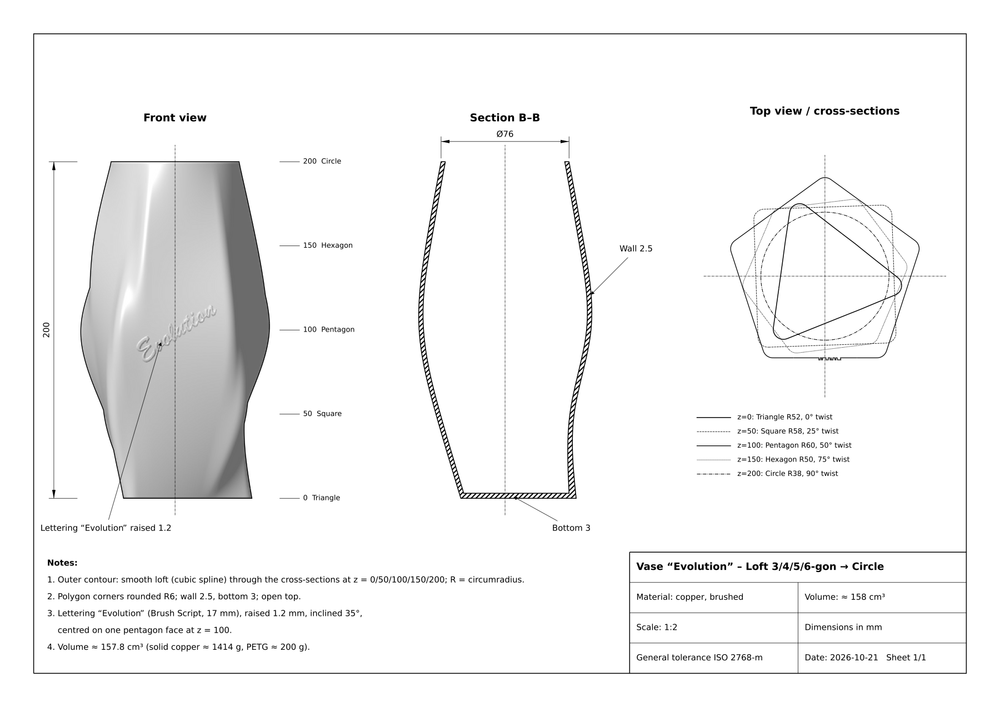
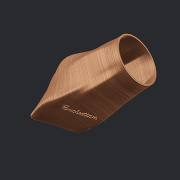

# Prompt: Vase „Evolution“

Erzeuge mit Python eine druckbare 3D-Vase und speichere alle Dateien im aktuellen Ordner.

## Form

- Höhe 200 mm, glatter, geschwungener Loft (kubische Spline des Radius r(θ) über die Höhe) durch diese Querschnitte:

| Höhe | Querschnitt | Umkreisradius | Verdrehung |
|---|---|---|---|
| 0 mm | Dreieck | 52 mm | 0° |
| 50 mm | Viereck | 58 mm | 25° |
| 100 mm | Fünfeck | 60 mm | 50° |
| 150 mm | Sechseck | 50 mm | 75° |
| 200 mm | Kreis | 38 mm | 90° |

- Polygonecken mit R 6 mm gerundet
- Wand 2,5 mm, Boden 3 mm, oben offen
- Ein geschlossener, manifold Körper, Boden auf z = 0

## Schriftzug

- „Evolution“ in Brush Script (`/System/Library/Fonts/Supplemental/Brush Script.ttf`), Schriftgröße 17 mm
- 1,2 mm erhaben, um 35° ansteigend gedreht
- Um die Außenwand gewickelt, mittig auf einer Fünfeckseite bei z = 100 mm (Winkel −112°)
- Der Schriftzug muss ganz auf dieser einen Fläche liegen.

## Ausgabe

1. **`vase_kupfer_evolution.stl`**: binäres STL in mm, für Cura
2. **`vase_kupfer_evolution.usdz`**: mit gebürstetem Kupfer
   - `UsdPreviewSurface`, metallic 1
   - Farbe rötlich, ≈ 0.88/0.42/0.26
   - Textur mit waagerecht umlaufenden Schleifriefen, die Farbe und Rauheit variieren
3. **`vase_evolution_drawing.pdf`**: technische Zeichnung, englisch, A4 quer, Maßstab 1:2
   - Front view auf die Schriftseite, schattiert, mit Höhe 200 und den Querschnittshöhen
   - Section B–B mit Öffnung Ø76, Wall 2.5, Bottom 3
   - Top view mit den übereinander gelegten Querschnitten und einer Legende
   - Notes und Schriftfeld: Material copper brushed, Scale 1:2, ISO 2768-m

Werkzeuge: `numpy`, `scipy`, `manifold3d` (Loft, Boolesche Operationen, Text extrudieren und mit `warp_batch` wickeln), `matplotlib` (TextPath, PDF), `moderngl` (schattierte Ansicht), `usd-core`.

Öffne danach die USDZ-Datei und das PDF in Vorschau.

## Erwartetes Ergebnis

- Volumen ≈ 158 cm³ (PETG ≈ 200 g)
- Genus 0
- Bounding Box etwa 111 × 112 × 200 mm

## Ergebnis

### Technische Zeichnung

PDF: [vase_evolution_drawing.pdf](vase_evolution_drawing.pdf) (englisch) · [vase_evolution_zeichnung.pdf](vase_evolution_zeichnung.pdf) (deutsch)

### Video

Volle Auflösung (1920 × 1080, 20 s): [vase_kupfer_evolution_drehung.mp4](vase_kupfer_evolution_drehung.mp4)
